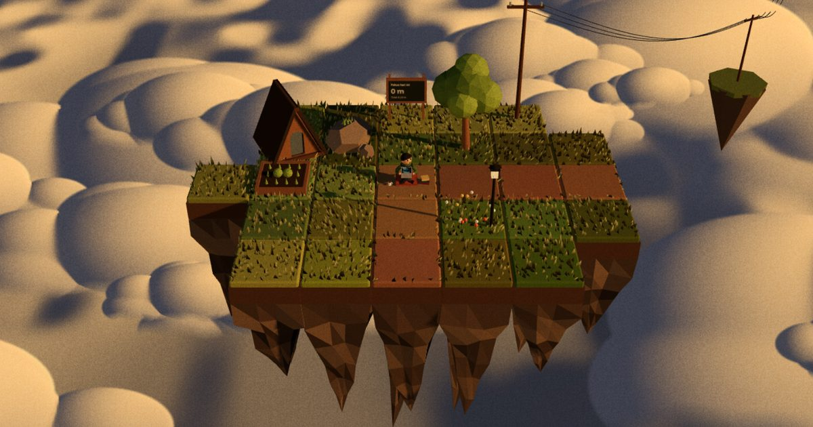

# CloudStead

Teman belajar di atas awan. Nyalakan timer fokus, putar musik YouTube-mu sendiri, dan lihat VMK
membangun pulau kecilnya: selama kamu fokus, dia menarik petak baru dari awan, menanam kebun, memasang
pondok, sampai membuka air terjun ke lautan awan. Pulaunya tidak pernah berubah sendiri; semua dibangun
VMK.



## Menjalankan

```bash
npm install
npm run dev      # http://localhost:5173
npm run build    # hasil di dist/
npm run preview
```

Butuh Node 20 atau lebih baru dan browser dengan WebGL. Tanpa WebGL, timer, musik, dan progres
tetap berjalan; hanya pulaunya yang tidak tergambar.

## Database

Server kecil (Express dan MySQL) menyimpan riwayat fokus dan salinan simpanan pulau. Situsnya tetap jalan
tanpa server: progres tetap di browser, dan blok fokus yang selesai menunggu di antrean browser sampai server
menjawab.

```bash
cp .env.example .env   # isi DB_USER dan DB_PASSWORD akun MySQL-mu
npm run server         # API di http://localhost:8791, membuat database cloudstead dan tabelnya sendiri
npm run dev            # /api diteruskan ke server
```

Server butuh Node 22 atau lebih baru dan MySQL 8. Setelah `npm run build`, `npm start` menyajikan `dist/`
dan API di port yang sama.

Selama server jalan, CloudStead minta masuk dulu (username dan kata sandi, minimal 6 karakter). Daftar dari
browser yang sudah punya pulau membawa pulau itu ke akun baru; masuk di browser lain memuat pulau akun itu;
keluar menghapus pulau dari browser itu (pulaunya tetap di akun). Kalau server mati, pulau tetap tumbuh di
browser dan ikut masuk ke akun begitu kamu mendaftar. Tabelnya: `users` dan `sessions` (akun, kapan daftar,
terakhir masuk, berapa kali masuk), `devices` (satu baris per akun), `saves` (salinan simpanan terbaru), dan
`events` (satu baris per blok fokus selesai).

```bash
npm run users                           # siapa saja yang punya akun, kapan daftar, dan apa yang tersimpan
npm run set-user -- <username> <sandi>  # buat akun, atau ganti kata sandinya (tidak ada reset lewat email)
```

## Cara kerja

- **Timer fokus.** Pola 25/5 (4 putaran, istirahat panjang 15 menit) atau 50/10 (3 putaran,
  istirahat panjang 20 menit). VMK hanya bekerja selama fase fokus berjalan.
- **VMK yang membangun.** 28 proyek, dari bunga liar di menit ke-5 sampai air terjun di 23 jam
  20 menit; pulau mulai dari 9 petak dan menjadi 37. Selama fase fokus berjalan, VMK mengerjakan
  proyek berikutnya dan hasilnya naik sedikit demi sedikit sesuai persentasenya:
  - bangunan: dia mengangkut kayu dari peti di tempat duduknya lalu memalu;
  - tanaman: dia menggali lalu menyiram;
  - petak baru: dia menariknya dari awan dengan tali;
  - perlengkapan (bantal, syal, kupluk, mug, buku, headphone): dia membuatnya sambil duduk.

  Saat istirahat VMK ikut istirahat. Tanpa timer dia jalan-jalan, menyiram tanaman, mengecek
  proyeknya, atau main laptop, dan proyeknya berhenti di persentase terakhir. Daftar lengkapnya ada
  di panel **Pulau** dan di [src/sim/milestones.ts](src/sim/milestones.ts).
- **Simpan dan reset.** Progres tersimpan otomatis di browser (localStorage). Tombol simpan
  (ikon disket, atau tombol S) menyimpan saat itu juga. Di panel **Pulau** ada unduh berkas
  simpanan (JSON), muat berkas, dan reset progres (dengan konfirmasi).
- **Pratinjau.** `?pratinjau=1400` menampilkan pulau setelah 1400 menit fokus tanpa menyentuh
  simpananmu.
- **Musik.** Tempel tautan YouTube atau YouTube Music (lagu, album, playlist publik). Ada dua
  radio Lofi Girl sebagai saran; alamat siaran langsung bisa berganti, jadi kalau salah satunya
  berhenti, ganti ID-nya di [src/music/links.ts](src/music/links.ts).
- **Suasana.** Waktu senja (bawaan), pagi, siang, malam, atau ikut jam. Suara pulau dibuat di
  browser: angin, burung siang dan jangkrik malam, suara kerja VMK (palu, sekop, tali, ketikan), dan
  suara selesai membangun.

## Bermain dengan VMK

- Arahkan kursor ke VMK: dia menoleh, dan kursor berubah menjadi "Sapa VMK".
- Klik untuk menyapa (saat bekerja, dia melambai dan bilang proyeknya sudah berapa persen).
- Tahan klik untuk mengelusnya.
- Nama "VMK" bisa diganti di panel **Pulau**.
- Klik kolam, kincir, pohon, dan bangunan lain; arahkan ke garis putus-putus untuk melihat kapan
  petak berikutnya naik.
- Seret untuk memutar pulau, gulir atau cubit untuk mendekat, klik dua kali di langit untuk
  mengembalikan kamera.

## Tombol keyboard

| Tombol | Fungsi |
| --- | --- |
| Spasi | Mulai atau jeda fokus |
| S | Simpan progres |
| P | Jeda atau lanjutkan pemandangan |
| M | Buka panel musik |
| Esc | Tutup panel |

## Struktur

```
src/
  main.ts            menyambungkan timer, progres, musik, pulau, dan antarmuka
  core/              emitter dan penyimpanan (localStorage, berkas simpanan)
  sim/               timer fokus, progres, daftar tahap pulau
  music/             pembaca tautan YouTube dan antrean pemutar
  audio/ambient.ts   suara pulau (Web Audio)
  scene/             Three.js: langit, awan, pulau petak, bangunan, lokasi konstruksi, VMK, partikel
  ui/                kursor dan panel musik
  core/cloud.ts      sambungan ke server: akun, antrean catatan, salinan simpanan
  ui/account.ts      layar masuk dan baris akun di panel Pulau
server/              Express dan MySQL: API, tabel, statistik fokus (project.js)
```

Arah desain dan alasannya ada di [DESIGN.md](DESIGN.md).
