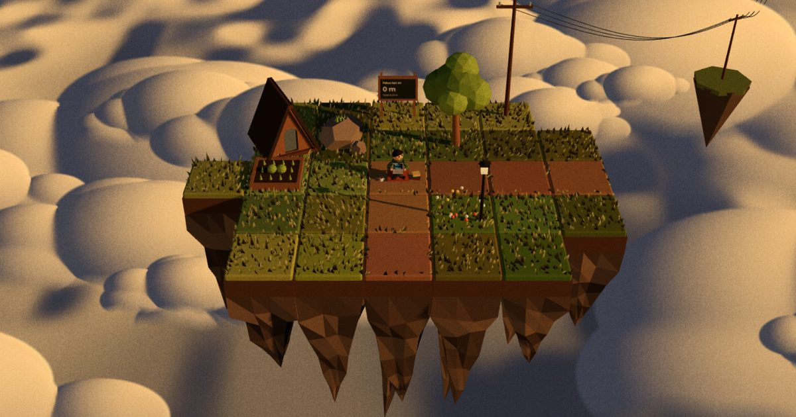

# CloudStead

Teman belajar di atas awan. Nyalakan timer fokus, putar musik YouTube-mu sendiri, dan lihat VMK
membangun pulau kecilnya: selama kamu fokus, dia menarik petak baru dari awan, menanam kebun, memasang
pondok, sampai membuka air terjun ke lautan awan. Pulaunya tidak pernah berubah sendiri; semua dibangun
VMK.



## Menjalankan

```bash
npm install
npm run dev      # http://localhost:5173
npm run build    # hasil di dist/
npm run preview
